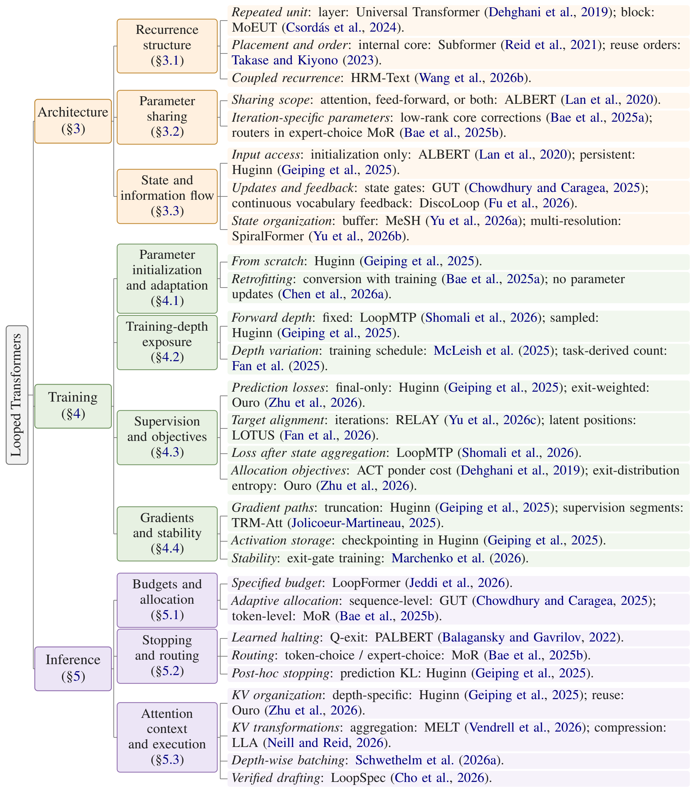

# Looped Transformers: Architectures, Training, Inference, and Evidence

Looped Transformers repeatedly apply shared layers or blocks to refine hidden representations, increasing computational depth while reusing parameters. This creates opportunities for parameter efficiency and flexible inference budgets, with benefits that depend on how recurrence is trained and executed. This collection covers recurrent-depth models for language modeling and NLP, organized around their architecture, training methods, and inference strategies.

## Contents

- [Taxonomy](#taxonomy)
- [Architecture](#architecture)
  - [Recurrence Structure](#recurrence-structure)
  - [Parameter Sharing](#parameter-sharing)
  - [State and Information Flow](#state-and-information-flow)
- [Training](#training)
  - [Parameter Initialization and Adaptation](#parameter-initialization-and-adaptation)
  - [Training-Depth Exposure](#training-depth-exposure)
  - [Supervision and Objectives](#supervision-and-objectives)
  - [Gradients and Stability](#gradients-and-stability)
- [Inference](#inference)
  - [Budgets and Allocation](#budgets-and-allocation)
  - [Stopping and Routing](#stopping-and-routing)
  - [Attention Context and Execution](#attention-context-and-execution)

## Taxonomy

The taxonomy organizes looped Transformers along three complementary design axes: **Architecture**, **Training**, and **Inference**. A work may appear in multiple branches when it addresses several design choices. The lists focus on models and methods that reuse Transformer computation across network depth.

  

## Architecture

Architecture specifies the repeated computation, its parameter-sharing scheme, and the state passed between iterations. Together, these choices determine what each recurrent update can do.

### Recurrence Structure

The repeated unit, its placement, and its execution order define the recurrence structure; interacting modules may also operate at different timescales.

#### Repeated unit

Each recurrence reapplies either a single Transformer layer or a block of distinct layers, so equal loop counts can represent different effective depths.

- **[Inner Thinking Transformer: Leveraging Dynamic Depth Scaling to Foster Adaptive Internal Thinking](https://aclanthology.org/2025.acl-long.1369/)** — Yilong Chen, Junyuan Shang, Zhenyu Zhang, Yanxi Xie, Jiawei Sheng, Tingwen Liu, Shuohuan Wang, Yu Sun, Hua Wu, Haifeng Wang. (ACL 2025)
- **[Relaxed Recursive Transformers: Effective Parameter Sharing with Layer-wise LoRA](https://proceedings.iclr.cc/paper_files/paper/2025/file/54d6a55225cebbdc16fbb0e45c5bdf2b-Paper-Conference.pdf)** — Sangmin Bae, Adam Fisch, Hrayr Harutyunyan, Ziwei Ji, Seungyeon Kim, Tal Schuster. (ICLR 2025)
- **[RingFormer: Rethinking Recurrent Transformer with Adaptive Level Signals](https://aclanthology.org/2025.findings-emnlp.1182/)** — Jaemu Heo, Eldor Fozilov, Hyunmin Song, Taehwan Kim. (Findings of EMNLP 2025)
- **[MoEUT: Mixture-of-Experts Universal Transformers](https://proceedings.neurips.cc/paper_files/paper/2024/file/321387ba926b8e58d3591c0aeb52ffc2-Paper-Conference.pdf)** — Róbert Csordás, Kazuki Irie, Jürgen Schmidhuber, Christopher Potts, Christopher D. Manning. (NeurIPS 2024)
- **[Looped Transformers as Programmable Computers](https://proceedings.mlr.press/v202/giannou23a.html)** — Angeliki Giannou, Shashank Rajput, Jy-Yong Sohn, Kangwook Lee, Jason D. Lee, Dimitris Papailiopoulos. (ICML 2023)
- **[Recurrent multiple shared layers in Depth for Neural Machine Translation](https://arxiv.org/abs/2108.10417)** — GuoLiang Li, Yiyang Li. (arXiv 2021)
- **[ALBERT: A Lite BERT for Self-supervised Learning of Language Representations](https://openreview.net/pdf?id=H1eA7AEtvS)** — Zhenzhong Lan, Mingda Chen, Sebastian Goodman, Kevin Gimpel, Piyush Sharma, Radu Soricut. (ICLR 2020)
- **[Recurrent stacking of layers for compact neural machine translation models](https://ojs.aaai.org/index.php/AAAI/article/view/4590)** — Raj Dabre, Atsushi Fujita. (AAAI 2019)
- **[Universal Transformers](https://openreview.net/pdf?id=HyzdRiR9Y7)** — Mostafa Dehghani, Stephan Gouws, Oriol Vinyals, Jakob Uszkoreit, Lukasz Kaiser. (ICLR 2019)

#### Placement and order

Recurrence can span most of the network or sit within an internal core; shared layers can follow sequential, cyclic, or reversed-cyclic reuse orders. Parallel loop architectures modify cross-loop dependencies to allow overlapping computation.

- **[LoopCoder-v2: Only Loop Once for Efficient Test-Time Computation Scaling](https://arxiv.org/abs/2606.18023)** — Jian Yang, Shawn Guo, Wei Zhang, Tianyu Zheng, Yaxin Du, Haau-Sing Li, Jiajun Wu, Yue Song, Yan Xing, Qingsong Cai, Zelong Huang, Chuan Hao, Ran Tao, Xianglong Liu, Wayne Xin Zhao, Mingjie Tang, Weifeng Lv, Ming Zhou, Bryan Dai. (arXiv 2026)
- **[Parcae: Scaling Laws For Stable Looped Language Models](https://arxiv.org/abs/2604.12946)** — Hayden Prairie, Zachary Novack, Taylor Berg-Kirkpatrick, Daniel Y. Fu. (arXiv 2026)
- **[Encode, Think, Decode: Scaling test-time reasoning with recursive latent thoughts](https://arxiv.org/abs/2510.07358)** — Yeskendir Koishekenov, Aldo Lipani, Nicola Cancedda. (arXiv 2025)
- **[Mixture-of-Recursions: Learning Dynamic Recursive Depths for Adaptive Token-Level Computation](https://proceedings.neurips.cc/paper_files/paper/2025/file/8b08bbf8b420faa6eeb4020720582ec7-Paper-Conference.pdf)** — Sangmin Bae, Yujin Kim, Reza Bayat, Sungnyun Kim, Jiyoun Ha, Tal Schuster, Adam Fisch, Hrayr Harutyunyan, Ziwei Ji, Aaron Courville, Se-Young Yun. (NeurIPS 2025)
- **[Parallel Loop Transformer for Efficient Test-Time Computation Scaling](https://arxiv.org/abs/2510.24824)** — Bohong Wu, Mengzhao Chen, Xiang Luo, Shen Yan, Qifan Yu, Fan Xia, Tianqi Zhang, Hongrui Zhan, Zheng Zhong, Xun Zhou, Siyuan Qiao, Xingyan Bin. (arXiv 2025)
- **[Scaling up Test-Time Compute with Latent Reasoning: A Recurrent Depth Approach](https://proceedings.neurips.cc/paper_files/paper/2025/file/3b01972cf31e6fa0fe29e4b8b5c2a0a1-Paper-Conference.pdf)** — Jonas Geiping, Sean McLeish, Neel Jain, John Kirchenbauer, Siddharth Singh, Brian Bartoldson, Bhavya Kailkhura, Abhinav Bhatele, Tom Goldstein. (NeurIPS 2025)
- **[Lessons on Parameter Sharing across Layers in Transformers](https://aclanthology.org/2023.sustainlp-1.5.pdf)** — Sho Takase, Shun Kiyono. (SustaiNLP 2023)
- **[Subformer: Exploring Weight Sharing for Parameter Efficiency in Generative Transformers](https://aclanthology.org/2021.findings-emnlp.344.pdf)** — Machel Reid, Edison Marrese-Taylor, Yutaka Matsuo. (Findings of EMNLP 2021)
- **[ALBERT: A Lite BERT for Self-supervised Learning of Language Representations](https://openreview.net/pdf?id=H1eA7AEtvS)** — Zhenzhong Lan, Mingda Chen, Sebastian Goodman, Kevin Gimpel, Piyush Sharma, Radu Soricut. (ICLR 2020)

#### Coupled recurrence

Hierarchical Reasoning Model (HRM) and HRM-Text couple low-level and high-level modules with separate states, performing multiple low-level updates for each high-level update.

- **[Hierarchical Reasoning Model](https://arxiv.org/abs/2506.21734)** — Guan Wang, Jin Li, Yuhao Sun, Xing Chen, Changling Liu, Yue Wu, Meng Lu, Sen Song, Yasin Abbasi Yadkori. (arXiv 2026)
- **[HRM-Text: Efficient Pretraining Beyond Scaling](https://arxiv.org/pdf/2605.20613)** — Guan Wang, Changling Liu, Chenyu Wang, Cai Zhou, Yuhao Sun, Yifei Wu, Shuai Zhen, Luca Scimeca, Yasin Abbasi Yadkori. (arXiv 2026)

### Parameter Sharing

Sharing is characterized by the components that reuse parameters and any additions specific to individual iterations or auxiliary controllers.

#### Sharing scope

Attention parameters, feed-forward parameters, or both can be shared across recurrent applications.

- **[MoEUT: Mixture-of-Experts Universal Transformers](https://proceedings.neurips.cc/paper_files/paper/2024/file/321387ba926b8e58d3591c0aeb52ffc2-Paper-Conference.pdf)** — Róbert Csordás, Kazuki Irie, Jürgen Schmidhuber, Christopher Potts, Christopher D. Manning. (NeurIPS 2024)
- **[Subformer: Exploring Weight Sharing for Parameter Efficiency in Generative Transformers](https://aclanthology.org/2021.findings-emnlp.344.pdf)** — Machel Reid, Edison Marrese-Taylor, Yutaka Matsuo. (Findings of EMNLP 2021)
- **[ALBERT: A Lite BERT for Self-supervised Learning of Language Representations](https://openreview.net/pdf?id=H1eA7AEtvS)** — Zhenzhong Lan, Mingda Chen, Sebastian Goodman, Kevin Gimpel, Piyush Sharma, Radu Soricut. (ICLR 2020)
- **[Universal Transformers](https://openreview.net/pdf?id=HyzdRiR9Y7)** — Mostafa Dehghani, Stephan Gouws, Oriol Vinyals, Jakob Uszkoreit, Lukasz Kaiser. (ICLR 2019)

#### Iteration-specific parameters

A shared core can be augmented with depth-specific low-rank corrections, learned iteration signals, hyper-connections, or recursion-specific routing parameters.

- **[Hyperloop Transformers](https://arxiv.org/abs/2604.21254)** — Abbas Zeitoun, Lucas Torroba-Hennigen, Yoon Kim. (arXiv 2026)
- **[MeSH: Memory-as-State-Highways for Recursive Transformers](https://proceedings.iclr.cc/paper_files/paper/2026/file/ef12378d988ef4dac37b200d1906056a-Paper-Conference.pdf)** — Chengting Yu, Xiaobo Shu, Yadao Wang, Yizhen Zhang, Haoyi Wu, Jiaang Li, Rujiao Long, Ziheng Chen, Yuchi Xu, wenbo su, Bo Zheng. (ICLR 2026)
- **[Inner Thinking Transformer: Leveraging Dynamic Depth Scaling to Foster Adaptive Internal Thinking](https://aclanthology.org/2025.acl-long.1369/)** — Yilong Chen, Junyuan Shang, Zhenyu Zhang, Yanxi Xie, Jiawei Sheng, Tingwen Liu, Shuohuan Wang, Yu Sun, Hua Wu, Haifeng Wang. (ACL 2025)
- **[Mixture-of-Recursions: Learning Dynamic Recursive Depths for Adaptive Token-Level Computation](https://proceedings.neurips.cc/paper_files/paper/2025/file/8b08bbf8b420faa6eeb4020720582ec7-Paper-Conference.pdf)** — Sangmin Bae, Yujin Kim, Reza Bayat, Sungnyun Kim, Jiyoun Ha, Tal Schuster, Adam Fisch, Hrayr Harutyunyan, Ziwei Ji, Aaron Courville, Se-Young Yun. (NeurIPS 2025)
- **[Relaxed Recursive Transformers: Effective Parameter Sharing with Layer-wise LoRA](https://proceedings.iclr.cc/paper_files/paper/2025/file/54d6a55225cebbdc16fbb0e45c5bdf2b-Paper-Conference.pdf)** — Sangmin Bae, Adam Fisch, Hrayr Harutyunyan, Ziwei Ji, Seungyeon Kim, Tal Schuster. (ICLR 2025)
- **[RingFormer: Rethinking Recurrent Transformer with Adaptive Level Signals](https://aclanthology.org/2025.findings-emnlp.1182/)** — Jaemu Heo, Eldor Fozilov, Hyunmin Song, Taehwan Kim. (Findings of EMNLP 2025)

#### Iteration conditioning and expert selection

Timestep or level signals, progress and step-size conditioning, and changing expert selections allow a shared core to perform different computations at successive depths.

- **[LoopFormer: Elastic-Depth Looped Transformers for Latent Reasoning via Shortcut Modulation](https://openreview.net/pdf?id=RzYXb5YWBs)** — Ahmadreza Jeddi, Marco Ciccone, Babak Taati. (ICLR 2026)
- **[On Expressive Power of Looped Transformers: Theoretical Analysis and Enhancement via Timestep Encoding](https://proceedings.mlr.press/v267/xu25x.html)** — Kevin Xu, Issei Sato. (ICML 2025)
- **[RingFormer: Rethinking Recurrent Transformer with Adaptive Level Signals](https://aclanthology.org/2025.findings-emnlp.1182/)** — Jaemu Heo, Eldor Fozilov, Hyunmin Song, Taehwan Kim. (Findings of EMNLP 2025)
- **[MoEUT: Mixture-of-Experts Universal Transformers](https://proceedings.neurips.cc/paper_files/paper/2024/file/321387ba926b8e58d3591c0aeb52ffc2-Paper-Conference.pdf)** — Róbert Csordás, Kazuki Irie, Jürgen Schmidhuber, Christopher Potts, Christopher D. Manning. (NeurIPS 2024)
- **[Sparse Universal Transformer](https://aclanthology.org/2023.emnlp-main.12/)** — Shawn Tan, Yikang Shen, Zhenfang Chen, Aaron Courville, Chuang Gan. (EMNLP 2023)
- **[Universal Transformers](https://openreview.net/pdf?id=HyzdRiR9Y7)** — Mostafa Dehghani, Stephan Gouws, Oriol Vinyals, Jakob Uszkoreit, Lukasz Kaiser. (ICLR 2019)

### State and Information Flow

The recurrent transition depends on how states are initialized, how input remains available, and what information is carried between updates.

#### Input access

Input representations can initialize the recurrent state once or remain available through persistent conditioning at every update.

- **[Parcae: Scaling Laws For Stable Looped Language Models](https://arxiv.org/abs/2604.12946)** — Hayden Prairie, Zachary Novack, Taylor Berg-Kirkpatrick, Daniel Y. Fu. (arXiv 2026)
- **[Scaling up Test-Time Compute with Latent Reasoning: A Recurrent Depth Approach](https://proceedings.neurips.cc/paper_files/paper/2025/file/3b01972cf31e6fa0fe29e4b8b5c2a0a1-Paper-Conference.pdf)** — Jonas Geiping, Sean McLeish, Neel Jain, John Kirchenbauer, Siddharth Singh, Brian Bartoldson, Bhavya Kailkhura, Abhinav Bhatele, Tom Goldstein. (NeurIPS 2025)
- **[Looped Transformers are Better at Learning Learning Algorithms](https://proceedings.iclr.cc/paper_files/paper/2024/file/b8402301e7f06bdc97a31bfaa653dc32-Paper-Conference.pdf)** — Liu Yang, Kangwook Lee, Robert Nowak, Dimitris Papailiopoulos. (ICLR 2024)
- **[ALBERT: A Lite BERT for Self-supervised Learning of Language Representations](https://openreview.net/pdf?id=H1eA7AEtvS)** — Zhenzhong Lan, Mingda Chen, Sebastian Goodman, Kevin Gimpel, Piyush Sharma, Radu Soricut. (ICLR 2020)

#### Updates and feedback

Gates, routing weights, and constrained state mixing control recurrent updates. DiscoLoop feeds probability-weighted token embeddings into the evolving hidden state, while PonderLM accumulates them in the input representation supplied to subsequent model calls.

- **[DiscoLoop: Looping Discrete Embeddings and Continuous Hidden States for Multi-hop Reasoning](https://arxiv.org/pdf/2607.00341)** — Hengyu Fu, Tianyu Guo, Zixuan Wang, Hanlin Zhu, Jason D. Lee, Jiantao Jiao, Stuart Russell, Song Mei. (arXiv 2026)
- **[Parcae: Scaling Laws For Stable Looped Language Models](https://arxiv.org/abs/2604.12946)** — Hayden Prairie, Zachary Novack, Taylor Berg-Kirkpatrick, Daniel Y. Fu. (arXiv 2026)
- **[PonderLM: Pretraining Language Models to Ponder in Continuous Space](https://proceedings.iclr.cc/paper_files/paper/2026/file/94572a66c6b0710c5263f15d8ef6b463-Paper-Conference.pdf)** — Boyi Zeng, Shixiang Song, Siyuan Huang, Yixuan Wang, He Li, Ziwei He, Xinbing Wang, Zhiyu li, Zhouhan Lin. (ICLR 2026)
- **[Inner Thinking Transformer: Leveraging Dynamic Depth Scaling to Foster Adaptive Internal Thinking](https://aclanthology.org/2025.acl-long.1369/)** — Yilong Chen, Junyuan Shang, Zhenyu Zhang, Yanxi Xie, Jiawei Sheng, Tingwen Liu, Shuohuan Wang, Yu Sun, Hua Wu, Haifeng Wang. (ACL 2025)
- **[Investigating Recurrent Transformers with Dynamic Halt](https://arxiv.org/pdf/2402.00976)** — Jishnu Ray Chowdhury, Cornelia Caragea. (arXiv 2025)
- **[Mixture-of-Recursions: Learning Dynamic Recursive Depths for Adaptive Token-Level Computation](https://proceedings.neurips.cc/paper_files/paper/2025/file/8b08bbf8b420faa6eeb4020720582ec7-Paper-Conference.pdf)** — Sangmin Bae, Yujin Kim, Reza Bayat, Sungnyun Kim, Jiyoun Ha, Tal Schuster, Adam Fisch, Hrayr Harutyunyan, Ziwei Ji, Aaron Courville, Se-Young Yun. (NeurIPS 2025)

#### State organization

Recurrent state can use a memory buffer, parallel residual streams, or representations at multiple sequence resolutions to carry information between updates.

- **[Hyperloop Transformers](https://arxiv.org/abs/2604.21254)** — Abbas Zeitoun, Lucas Torroba-Hennigen, Yoon Kim. (arXiv 2026)
- **[MeSH: Memory-as-State-Highways for Recursive Transformers](https://proceedings.iclr.cc/paper_files/paper/2026/file/ef12378d988ef4dac37b200d1906056a-Paper-Conference.pdf)** — Chengting Yu, Xiaobo Shu, Yadao Wang, Yizhen Zhang, Haoyi Wu, Jiaang Li, Rujiao Long, Ziheng Chen, Yuchi Xu, wenbo su, Bo Zheng. (ICLR 2026)
- **[SpiralFormer: Looped Transformers Can Learn Hierarchical Dependencies via Multi-Resolution Recursion](https://arxiv.org/pdf/2602.11698)** — Chengting Yu, Xiaobo Shu, Yadao Wang, Yizhen Zhang, Haoyi Wu, You Wu, Rujiao Long, Ziheng Chen, Yuchi Xu, Wenbo Su, Bo Zheng. (arXiv 2026)

## Training

Training determines how repeated computation becomes useful through initialization, depth exposure, supervision, and optimization. Forward depth, supervised iterations, and the gradient horizon are separate choices.

### Parameter Initialization and Adaptation

Recurrent models can be trained from scratch or constructed from pretrained models, with different costs for pretraining, adaptation, and inference.

#### From scratch

Shared recurrent computation is learned from the beginning of model training.

- **[Closing the Loop: Practical Training Recipes for Looped Language Models](https://arxiv.org/pdf/2610.00673)** — Andrei Marchenko, Viacheslav Bezrukov, Oleg Kashurin, Inessa Fedorova, Dmitry Bocharov, Yuliana Shakhvalieva, Maria Tikhonova, Valerii Ternovskii. (arXiv 2026)
- **[Parcae: Scaling Laws For Stable Looped Language Models](https://arxiv.org/abs/2604.12946)** — Hayden Prairie, Zachary Novack, Taylor Berg-Kirkpatrick, Daniel Y. Fu. (arXiv 2026)
- **[Scaling Latent Reasoning via Looped Language Models](https://arxiv.org/pdf/2510.25741)** — Rui-Jie Zhu, Zixuan Wang, Kai Hua, Tianyu Zhang, Ziniu Li, Haoran Que, Boyi Wei, Zixin Wen, Fan Yin, He Xing, Lu Li, Jiajun Shi, Kaijing Ma, Shanda Li, Taylor Kergan, Andrew Smith, Xingwei Qu, Mude Hui, Bohong Wu, Qiyang Min, Hongzhi Huang, Xun Zhou, Wei Ye, Jiaheng Liu, Jian Yang, Yunfeng Shi, Chenghua Lin, Enduo Zhao, Tianle Cai, Ge Zhang, Wenhao Huang, Yoshua Bengio, Jason Eshraghian. (arXiv 2026)
- **[Mixture-of-Recursions: Learning Dynamic Recursive Depths for Adaptive Token-Level Computation](https://proceedings.neurips.cc/paper_files/paper/2025/file/8b08bbf8b420faa6eeb4020720582ec7-Paper-Conference.pdf)** — Sangmin Bae, Yujin Kim, Reza Bayat, Sungnyun Kim, Jiyoun Ha, Tal Schuster, Adam Fisch, Hrayr Harutyunyan, Ziwei Ji, Aaron Courville, Se-Young Yun. (NeurIPS 2025)
- **[Scaling up Test-Time Compute with Latent Reasoning: A Recurrent Depth Approach](https://proceedings.neurips.cc/paper_files/paper/2025/file/3b01972cf31e6fa0fe29e4b8b5c2a0a1-Paper-Conference.pdf)** — Jonas Geiping, Sean McLeish, Neel Jain, John Kirchenbauer, Siddharth Singh, Brian Bartoldson, Bhavya Kailkhura, Abhinav Bhatele, Tom Goldstein. (NeurIPS 2025)

#### Retrofitting

Pretrained layers are converted into recurrent computation, with options for further training or reuse of frozen parameters.

- **[Closing the Loop: Practical Training Recipes for Looped Language Models](https://arxiv.org/pdf/2610.00673)** — Andrei Marchenko, Viacheslav Bezrukov, Oleg Kashurin, Inessa Fedorova, Dmitry Bocharov, Yuliana Shakhvalieva, Maria Tikhonova, Valerii Ternovskii. (arXiv 2026)
- **[Training-Free Looped Transformers](https://arxiv.org/pdf/2605.23872)** — Lizhang Chen, Jonathan Li, Chen Liang, Ni Lao, Qiang Liu. (arXiv 2026)
- **[Encode, Think, Decode: Scaling test-time reasoning with recursive latent thoughts](https://arxiv.org/abs/2510.07358)** — Yeskendir Koishekenov, Aldo Lipani, Nicola Cancedda. (arXiv 2025)
- **[Relaxed Recursive Transformers: Effective Parameter Sharing with Layer-wise LoRA](https://proceedings.iclr.cc/paper_files/paper/2025/file/54d6a55225cebbdc16fbb0e45c5bdf2b-Paper-Conference.pdf)** — Sangmin Bae, Adam Fisch, Hrayr Harutyunyan, Ziwei Ji, Seungyeon Kim, Tal Schuster. (ICLR 2025)
- **[Teaching Pretrained Language Models to Think Deeper with Retrofitted Recurrence](https://openreview.net/pdf?id=Oq3Xblt0x1)** — Sean Michael McLeish, Ang Li, John Kirchenbauer, Dayal Singh Kalra, Brian R. Bartoldson, Bhavya Kailkhura, Avi Schwarzschild, Jonas Geiping, Micah Goldblum, Tom Goldstein. (NeurIPS Efficient Reasoning Workshop 2025)

### Training-Depth Exposure

The depths executed during training provide the reference for evaluating generalization; depth extrapolation requires exceeding the maximum depth actually encountered.

#### Forward depth

Training can execute a fixed recurrence count, sample depths, or route tokens under depth and capacity constraints. In RL-Halting, training unrolls to a depth cap to construct a stopping distribution, while the prediction loss is evaluated at a sampled exit.

- **[Closing the Loop: Practical Training Recipes for Looped Language Models](https://arxiv.org/pdf/2610.00673)** — Andrei Marchenko, Viacheslav Bezrukov, Oleg Kashurin, Inessa Fedorova, Dmitry Bocharov, Yuliana Shakhvalieva, Maria Tikhonova, Valerii Ternovskii. (arXiv 2026)
- **[How Much Is One Recurrence Worth? Iso-Depth Scaling Laws for Looped Language Models](https://arxiv.org/abs/2604.21106)** — Kristian Schwethelm, Daniel Rueckert, Georgios Kaissis. (arXiv 2026)
- **[HRM-Text: Efficient Pretraining Beyond Scaling](https://arxiv.org/pdf/2605.20613)** — Guan Wang, Changling Liu, Chenyu Wang, Cai Zhou, Yuhao Sun, Yifei Wu, Shuai Zhen, Luca Scimeca, Yasin Abbasi Yadkori. (arXiv 2026)
- **[LoopFormer: Elastic-Depth Looped Transformers for Latent Reasoning via Shortcut Modulation](https://openreview.net/pdf?id=RzYXb5YWBs)** — Ahmadreza Jeddi, Marco Ciccone, Babak Taati. (ICLR 2026)
- **[LoopMTP: A looped transformer guided by latent multi-token prediction](https://arxiv.org/pdf/2608.03624)** — Behzad Shomali, Markus Frey, David Berghaus, Joachim Koehler, Mehdi Ali. (arXiv 2026)
- **[Parcae: Scaling Laws For Stable Looped Language Models](https://arxiv.org/abs/2604.12946)** — Hayden Prairie, Zachary Novack, Taylor Berg-Kirkpatrick, Daniel Y. Fu. (arXiv 2026)
- **[Stabilizing Extrapolation in Looped Transformers via Learned Stochastic Stopping](https://openreview.net/forum?id=xExWu1Bhuw)** — Hsun-Yu Kuo, El Mahdi Chayti, Patrik Reizinger, Wieland Brendel, Martin Jaggi. (AdaptFM 2026)
- **[Encode, Think, Decode: Scaling test-time reasoning with recursive latent thoughts](https://arxiv.org/abs/2510.07358)** — Yeskendir Koishekenov, Aldo Lipani, Nicola Cancedda. (arXiv 2025)
- **[Mixture-of-Recursions: Learning Dynamic Recursive Depths for Adaptive Token-Level Computation](https://proceedings.neurips.cc/paper_files/paper/2025/file/8b08bbf8b420faa6eeb4020720582ec7-Paper-Conference.pdf)** — Sangmin Bae, Yujin Kim, Reza Bayat, Sungnyun Kim, Jiyoun Ha, Tal Schuster, Adam Fisch, Hrayr Harutyunyan, Ziwei Ji, Aaron Courville, Se-Young Yun. (NeurIPS 2025)
- **[Scaling up Test-Time Compute with Latent Reasoning: A Recurrent Depth Approach](https://proceedings.neurips.cc/paper_files/paper/2025/file/3b01972cf31e6fa0fe29e4b8b5c2a0a1-Paper-Conference.pdf)** — Jonas Geiping, Sean McLeish, Neel Jain, John Kirchenbauer, Siddharth Singh, Brian Bartoldson, Bhavya Kailkhura, Abhinav Bhatele, Tom Goldstein. (NeurIPS 2025)

#### Depth variation

Recurrence counts or their sampling distributions can follow a training schedule. Task-derived counts can also assign different depths to individual examples.

- **[Enhancing Auto-regressive Chain-of-Thought through Loop-Aligned Reasoning](https://aclanthology.org/2026.eacl-long.97.pdf)** — Qifan Yu, Zhenyu He, Sijie Li, Zhou Xun, Jun Zhang, Jingjing Xu, Di He. (EACL 2026)
- **[Scaling Latent Reasoning via Looped Language Models](https://arxiv.org/pdf/2510.25741)** — Rui-Jie Zhu, Zixuan Wang, Kai Hua, Tianyu Zhang, Ziniu Li, Haoran Que, Boyi Wei, Zixin Wen, Fan Yin, He Xing, Lu Li, Jiajun Shi, Kaijing Ma, Shanda Li, Taylor Kergan, Andrew Smith, Xingwei Qu, Mude Hui, Bohong Wu, Qiyang Min, Hongzhi Huang, Xun Zhou, Wei Ye, Jiaheng Liu, Jian Yang, Yunfeng Shi, Chenghua Lin, Enduo Zhao, Tianle Cai, Ge Zhang, Wenhao Huang, Yoshua Bengio, Jason Eshraghian. (arXiv 2026)
- **[Looped Transformers for Length Generalization](https://proceedings.iclr.cc/paper_files/paper/2025/file/25cc3adf8c85f7c70989cb8a97a691a7-Paper-Conference.pdf)** — Ying Fan, Yilun Du, Kannan Ramchandran, Kangwook Lee. (ICLR 2025)
- **[Teaching Pretrained Language Models to Think Deeper with Retrofitted Recurrence](https://openreview.net/pdf?id=Oq3Xblt0x1)** — Sean Michael McLeish, Ang Li, John Kirchenbauer, Dayal Singh Kalra, Brian R. Bartoldson, Bhavya Kailkhura, Avi Schwarzschild, Jonas Geiping, Micah Goldblum, Tom Goldstein. (NeurIPS Efficient Reasoning Workshop 2025)
- **[Looped Transformers are Better at Learning Learning Algorithms](https://proceedings.iclr.cc/paper_files/paper/2024/file/b8402301e7f06bdc97a31bfaa653dc32-Paper-Conference.pdf)** — Liu Yang, Kangwook Lee, Robert Nowak, Dimitris Papailiopoulos. (ICLR 2024)

### Supervision and Objectives

Training objectives specify which recurrent states receive prediction losses, what they should predict, and how computation allocation is encouraged.

#### Prediction losses

Prediction losses can supervise the final iteration, a selected window, multiple intermediate predictions, or supervision-segment boundaries. Weights can be fixed or derived from learned exit probabilities; RL-Halting evaluates the task loss at a sampled exit.

- **[Closing the Loop: Practical Training Recipes for Looped Language Models](https://arxiv.org/pdf/2610.00673)** — Andrei Marchenko, Viacheslav Bezrukov, Oleg Kashurin, Inessa Fedorova, Dmitry Bocharov, Yuliana Shakhvalieva, Maria Tikhonova, Valerii Ternovskii. (arXiv 2026)
- **[HRM-Text: Efficient Pretraining Beyond Scaling](https://arxiv.org/pdf/2605.20613)** — Guan Wang, Changling Liu, Chenyu Wang, Cai Zhou, Yuhao Sun, Yifei Wu, Shuai Zhen, Luca Scimeca, Yasin Abbasi Yadkori. (arXiv 2026)
- **[LoopFormer: Elastic-Depth Looped Transformers for Latent Reasoning via Shortcut Modulation](https://openreview.net/pdf?id=RzYXb5YWBs)** — Ahmadreza Jeddi, Marco Ciccone, Babak Taati. (ICLR 2026)
- **[Scaling Latent Reasoning via Looped Language Models](https://arxiv.org/pdf/2510.25741)** — Rui-Jie Zhu, Zixuan Wang, Kai Hua, Tianyu Zhang, Ziniu Li, Haoran Que, Boyi Wei, Zixin Wen, Fan Yin, He Xing, Lu Li, Jiajun Shi, Kaijing Ma, Shanda Li, Taylor Kergan, Andrew Smith, Xingwei Qu, Mude Hui, Bohong Wu, Qiyang Min, Hongzhi Huang, Xun Zhou, Wei Ye, Jiaheng Liu, Jian Yang, Yunfeng Shi, Chenghua Lin, Enduo Zhao, Tianle Cai, Ge Zhang, Wenhao Huang, Yoshua Bengio, Jason Eshraghian. (arXiv 2026)
- **[Stabilizing Extrapolation in Looped Transformers via Learned Stochastic Stopping](https://openreview.net/forum?id=xExWu1Bhuw)** — Hsun-Yu Kuo, El Mahdi Chayti, Patrik Reizinger, Wieland Brendel, Martin Jaggi. (AdaptFM 2026)
- **[Less is More: Recursive Reasoning with Tiny Networks](https://arxiv.org/pdf/2510.04871)** — Alexia Jolicoeur-Martineau. (arXiv 2025)
- **[Looped Transformers for Length Generalization](https://proceedings.iclr.cc/paper_files/paper/2025/file/25cc3adf8c85f7c70989cb8a97a691a7-Paper-Conference.pdf)** — Ying Fan, Yilun Du, Kannan Ramchandran, Kangwook Lee. (ICLR 2025)
- **[Mixture-of-Recursions: Learning Dynamic Recursive Depths for Adaptive Token-Level Computation](https://proceedings.neurips.cc/paper_files/paper/2025/file/8b08bbf8b420faa6eeb4020720582ec7-Paper-Conference.pdf)** — Sangmin Bae, Yujin Kim, Reza Bayat, Sungnyun Kim, Jiyoun Ha, Tal Schuster, Adam Fisch, Hrayr Harutyunyan, Ziwei Ji, Aaron Courville, Se-Young Yun. (NeurIPS 2025)
- **[Relaxed Recursive Transformers: Effective Parameter Sharing with Layer-wise LoRA](https://proceedings.iclr.cc/paper_files/paper/2025/file/54d6a55225cebbdc16fbb0e45c5bdf2b-Paper-Conference.pdf)** — Sangmin Bae, Adam Fisch, Hrayr Harutyunyan, Ziwei Ji, Seungyeon Kim, Tal Schuster. (ICLR 2025)
- **[Scaling up Test-Time Compute with Latent Reasoning: A Recurrent Depth Approach](https://proceedings.neurips.cc/paper_files/paper/2025/file/3b01972cf31e6fa0fe29e4b8b5c2a0a1-Paper-Conference.pdf)** — Jonas Geiping, Sean McLeish, Neel Jain, John Kirchenbauer, Siddharth Singh, Brian Bartoldson, Bhavya Kailkhura, Abhinav Bhatele, Tom Goldstein. (NeurIPS 2025)
- **[Teaching Pretrained Language Models to Think Deeper with Retrofitted Recurrence](https://openreview.net/pdf?id=Oq3Xblt0x1)** — Sean Michael McLeish, Ang Li, John Kirchenbauer, Dayal Singh Kalra, Brian R. Bartoldson, Bhavya Kailkhura, Avi Schwarzschild, Jonas Geiping, Micah Goldblum, Tom Goldstein. (NeurIPS Efficient Reasoning Workshop 2025)
- **[Looped Transformers are Better at Learning Learning Algorithms](https://proceedings.iclr.cc/paper_files/paper/2024/file/b8402301e7f06bdc97a31bfaa653dc32-Paper-Conference.pdf)** — Liu Yang, Kangwook Lee, Robert Nowak, Dimitris Papailiopoulos. (ICLR 2024)

#### Target alignment

Structured targets can align reasoning steps with recurrent iterations or with latent sequence positions after recurrence.

- **[Bridging the Gap Between Latent and Explicit Reasoning with Looped Transformers](https://arxiv.org/pdf/2606.31779)** — Ying Fan, Anej Svete, Kangwook Lee. (arXiv 2026)
- **[Enhancing Auto-regressive Chain-of-Thought through Loop-Aligned Reasoning](https://aclanthology.org/2026.eacl-long.97.pdf)** — Qifan Yu, Zhenyu He, Sijie Li, Zhou Xun, Jun Zhang, Jingjing Xu, Di He. (EACL 2026)
- **[LoopMTP: A looped transformer guided by latent multi-token prediction](https://arxiv.org/pdf/2608.03624)** — Behzad Shomali, Markus Frey, David Berghaus, Joachim Koehler, Mehdi Ali. (arXiv 2026)

#### Loss after state aggregation

Intermediate states or predictions can be combined before applying a main prediction loss, with auxiliary supervision of individual states in some designs.

- **[LoopMTP: A looped transformer guided by latent multi-token prediction](https://arxiv.org/pdf/2608.03624)** — Behzad Shomali, Markus Frey, David Berghaus, Joachim Koehler, Mehdi Ali. (arXiv 2026)
- **[Universal Transformers](https://openreview.net/pdf?id=HyzdRiR9Y7)** — Mostafa Dehghani, Stephan Gouws, Oriol Vinyals, Jakob Uszkoreit, Lukasz Kaiser. (ICLR 2019)

#### Allocation objectives

Ponder costs and exit-distribution regularization shape learned computation budgets. Routing objectives supervise causal token assignments and balance capacity across depths.

- **[Closing the Loop: Practical Training Recipes for Looped Language Models](https://arxiv.org/pdf/2610.00673)** — Andrei Marchenko, Viacheslav Bezrukov, Oleg Kashurin, Inessa Fedorova, Dmitry Bocharov, Yuliana Shakhvalieva, Maria Tikhonova, Valerii Ternovskii. (arXiv 2026)
- **[Scaling Latent Reasoning via Looped Language Models](https://arxiv.org/pdf/2510.25741)** — Rui-Jie Zhu, Zixuan Wang, Kai Hua, Tianyu Zhang, Ziniu Li, Haoran Que, Boyi Wei, Zixin Wen, Fan Yin, He Xing, Lu Li, Jiajun Shi, Kaijing Ma, Shanda Li, Taylor Kergan, Andrew Smith, Xingwei Qu, Mude Hui, Bohong Wu, Qiyang Min, Hongzhi Huang, Xun Zhou, Wei Ye, Jiaheng Liu, Jian Yang, Yunfeng Shi, Chenghua Lin, Enduo Zhao, Tianle Cai, Ge Zhang, Wenhao Huang, Yoshua Bengio, Jason Eshraghian. (arXiv 2026)
- **[Stabilizing Extrapolation in Looped Transformers via Learned Stochastic Stopping](https://openreview.net/forum?id=xExWu1Bhuw)** — Hsun-Yu Kuo, El Mahdi Chayti, Patrik Reizinger, Wieland Brendel, Martin Jaggi. (AdaptFM 2026)
- **[Mixture-of-Recursions: Learning Dynamic Recursive Depths for Adaptive Token-Level Computation](https://proceedings.neurips.cc/paper_files/paper/2025/file/8b08bbf8b420faa6eeb4020720582ec7-Paper-Conference.pdf)** — Sangmin Bae, Yujin Kim, Reza Bayat, Sungnyun Kim, Jiyoun Ha, Tal Schuster, Adam Fisch, Hrayr Harutyunyan, Ziwei Ji, Aaron Courville, Se-Young Yun. (NeurIPS 2025)
- **[Universal Transformers](https://openreview.net/pdf?id=HyzdRiR9Y7)** — Mostafa Dehghani, Stephan Gouws, Oriol Vinyals, Jakob Uszkoreit, Lukasz Kaiser. (ICLR 2019)

#### Reinforcement objectives

Policy-gradient objectives can train stopping decisions, while reinforcement learning over recurrent latent trajectories can reward useful intermediate computation and final outputs.

- **[Prioritize the Process, Not Just the Outcome: Rewarding Latent Thought Trajectories Improves Reasoning in Looped Language Models](https://openreview.net/forum?id=cPAgJwcn3h)** — Jonathan Williams, Olga Russakovsky, Esin Tureci. (ICML 2026)
- **[Stabilizing Extrapolation in Looped Transformers via Learned Stochastic Stopping](https://openreview.net/forum?id=xExWu1Bhuw)** — Hsun-Yu Kuo, El Mahdi Chayti, Patrik Reizinger, Wieland Brendel, Martin Jaggi. (AdaptFM 2026)

### Gradients and Stability

Loss placement, gradient propagation, and activation storage shape optimization in different ways, alongside the stability of recurrent states and exit gates.

#### Gradient paths

Truncated backpropagation limits the recurrent dependencies that receive gradients. TRM-Att, the Transformer variant of Less is More, retains gradients through the final complete recursion of each supervision segment and detaches states between segments. LoopFormer also uses stop-gradient consistency targets between trajectory endpoints.

- **[HRM-Text: Efficient Pretraining Beyond Scaling](https://arxiv.org/pdf/2605.20613)** — Guan Wang, Changling Liu, Chenyu Wang, Cai Zhou, Yuhao Sun, Yifei Wu, Shuai Zhen, Luca Scimeca, Yasin Abbasi Yadkori. (arXiv 2026)
- **[LoopFormer: Elastic-Depth Looped Transformers for Latent Reasoning via Shortcut Modulation](https://openreview.net/pdf?id=RzYXb5YWBs)** — Ahmadreza Jeddi, Marco Ciccone, Babak Taati. (ICLR 2026)
- **[Less is More: Recursive Reasoning with Tiny Networks](https://arxiv.org/pdf/2510.04871)** — Alexia Jolicoeur-Martineau. (arXiv 2025)
- **[Scaling up Test-Time Compute with Latent Reasoning: A Recurrent Depth Approach](https://proceedings.neurips.cc/paper_files/paper/2025/file/3b01972cf31e6fa0fe29e4b8b5c2a0a1-Paper-Conference.pdf)** — Jonas Geiping, Sean McLeish, Neel Jain, John Kirchenbauer, Siddharth Singh, Brian Bartoldson, Bhavya Kailkhura, Abhinav Bhatele, Tom Goldstein. (NeurIPS 2025)
- **[Teaching Pretrained Language Models to Think Deeper with Retrofitted Recurrence](https://openreview.net/pdf?id=Oq3Xblt0x1)** — Sean Michael McLeish, Ang Li, John Kirchenbauer, Dayal Singh Kalra, Brian R. Bartoldson, Bhavya Kailkhura, Avi Schwarzschild, Jonas Geiping, Micah Goldblum, Tom Goldstein. (NeurIPS Efficient Reasoning Workshop 2025)
- **[Looped Transformers are Better at Learning Learning Algorithms](https://proceedings.iclr.cc/paper_files/paper/2024/file/b8402301e7f06bdc97a31bfaa653dc32-Paper-Conference.pdf)** — Liu Yang, Kangwook Lee, Robert Nowak, Dimitris Papailiopoulos. (ICLR 2024)

#### Activation storage

Activation checkpointing reduces memory use by recomputing intermediate activations while preserving gradient propagation through the retained graph.

- **[Scaling up Test-Time Compute with Latent Reasoning: A Recurrent Depth Approach](https://proceedings.neurips.cc/paper_files/paper/2025/file/3b01972cf31e6fa0fe29e4b8b5c2a0a1-Paper-Conference.pdf)** — Jonas Geiping, Sean McLeish, Neel Jain, John Kirchenbauer, Siddharth Singh, Brian Bartoldson, Bhavya Kailkhura, Abhinav Bhatele, Tom Goldstein. (NeurIPS 2025)

#### Stability

Training and halting recipes address state collapse, uncontrolled recurrent-state norms, and premature exit-gate collapse. State conditioning, readout design, and learned stopping affect how useful additional iterations become.

- **[Closing the Loop: Practical Training Recipes for Looped Language Models](https://arxiv.org/pdf/2610.00673)** — Andrei Marchenko, Viacheslav Bezrukov, Oleg Kashurin, Inessa Fedorova, Dmitry Bocharov, Yuliana Shakhvalieva, Maria Tikhonova, Valerii Ternovskii. (arXiv 2026)
- **[Dense Supervision Is Not Enough: The Readout Blind Spot in Looped Language Models](https://arxiv.org/abs/2606.24898)** — Rituraj Sharma, Tu Vu. (arXiv 2026)
- **[Parcae: Scaling Laws For Stable Looped Language Models](https://arxiv.org/abs/2604.12946)** — Hayden Prairie, Zachary Novack, Taylor Berg-Kirkpatrick, Daniel Y. Fu. (arXiv 2026)
- **[Stabilizing Extrapolation in Looped Transformers via Learned Stochastic Stopping](https://openreview.net/forum?id=xExWu1Bhuw)** — Hsun-Yu Kuo, El Mahdi Chayti, Patrik Reizinger, Wieland Brendel, Martin Jaggi. (AdaptFM 2026)
- **[Scaling up Test-Time Compute with Latent Reasoning: A Recurrent Depth Approach](https://proceedings.neurips.cc/paper_files/paper/2025/file/3b01972cf31e6fa0fe29e4b8b5c2a0a1-Paper-Conference.pdf)** — Jonas Geiping, Sean McLeish, Neel Jain, John Kirchenbauer, Siddharth Singh, Brian Bartoldson, Bhavya Kailkhura, Abhinav Bhatele, Tom Goldstein. (NeurIPS 2025)

## Inference

Inference determines how much recurrent computation to execute, where to allocate it, and how to support it with attention, caching, and scheduling. Selecting an early prediction saves computation only when later updates are skipped.

### Budgets and Allocation

A budget sets the available recurrent computation, while allocation determines how that computation is distributed across sequences or tokens.

#### Specified budget

A recurrence budget can be set globally or per request. LoopFormer conditions updates on progress and step size to adapt its trajectory to that budget; some fixed-loop studies instead train separate configurations for each loop count.

- **[LoopCoder-v2: Only Loop Once for Efficient Test-Time Computation Scaling](https://arxiv.org/abs/2606.18023)** — Jian Yang, Shawn Guo, Wei Zhang, Tianyu Zheng, Yaxin Du, Haau-Sing Li, Jiajun Wu, Yue Song, Yan Xing, Qingsong Cai, Zelong Huang, Chuan Hao, Ran Tao, Xianglong Liu, Wayne Xin Zhao, Mingjie Tang, Weifeng Lv, Ming Zhou, Bryan Dai. (arXiv 2026)
- **[LoopFormer: Elastic-Depth Looped Transformers for Latent Reasoning via Shortcut Modulation](https://openreview.net/pdf?id=RzYXb5YWBs)** — Ahmadreza Jeddi, Marco Ciccone, Babak Taati. (ICLR 2026)
- **[Encode, Think, Decode: Scaling test-time reasoning with recursive latent thoughts](https://arxiv.org/abs/2510.07358)** — Yeskendir Koishekenov, Aldo Lipani, Nicola Cancedda. (arXiv 2025)
- **[Looped Transformers for Length Generalization](https://proceedings.iclr.cc/paper_files/paper/2025/file/25cc3adf8c85f7c70989cb8a97a691a7-Paper-Conference.pdf)** — Ying Fan, Yilun Du, Kannan Ramchandran, Kangwook Lee. (ICLR 2025)
- **[Scaling up Test-Time Compute with Latent Reasoning: A Recurrent Depth Approach](https://proceedings.neurips.cc/paper_files/paper/2025/file/3b01972cf31e6fa0fe29e4b8b5c2a0a1-Paper-Conference.pdf)** — Jonas Geiping, Sean McLeish, Neel Jain, John Kirchenbauer, Siddharth Singh, Brian Bartoldson, Bhavya Kailkhura, Abhinav Bhatele, Tom Goldstein. (NeurIPS 2025)

#### Adaptive allocation

Computation can vary across whole sequences or individual tokens according to the input and intermediate states.

- **[Scaling Latent Reasoning via Looped Language Models](https://arxiv.org/pdf/2510.25741)** — Rui-Jie Zhu, Zixuan Wang, Kai Hua, Tianyu Zhang, Ziniu Li, Haoran Que, Boyi Wei, Zixin Wen, Fan Yin, He Xing, Lu Li, Jiajun Shi, Kaijing Ma, Shanda Li, Taylor Kergan, Andrew Smith, Xingwei Qu, Mude Hui, Bohong Wu, Qiyang Min, Hongzhi Huang, Xun Zhou, Wei Ye, Jiaheng Liu, Jian Yang, Yunfeng Shi, Chenghua Lin, Enduo Zhao, Tianle Cai, Ge Zhang, Wenhao Huang, Yoshua Bengio, Jason Eshraghian. (arXiv 2026)
- **[Stabilizing Extrapolation in Looped Transformers via Learned Stochastic Stopping](https://openreview.net/forum?id=xExWu1Bhuw)** — Hsun-Yu Kuo, El Mahdi Chayti, Patrik Reizinger, Wieland Brendel, Martin Jaggi. (AdaptFM 2026)
- **[Inner Thinking Transformer: Leveraging Dynamic Depth Scaling to Foster Adaptive Internal Thinking](https://aclanthology.org/2025.acl-long.1369/)** — Yilong Chen, Junyuan Shang, Zhenyu Zhang, Yanxi Xie, Jiawei Sheng, Tingwen Liu, Shuohuan Wang, Yu Sun, Hua Wu, Haifeng Wang. (ACL 2025)
- **[Investigating Recurrent Transformers with Dynamic Halt](https://arxiv.org/pdf/2402.00976)** — Jishnu Ray Chowdhury, Cornelia Caragea. (arXiv 2025)
- **[Mixture-of-Recursions: Learning Dynamic Recursive Depths for Adaptive Token-Level Computation](https://proceedings.neurips.cc/paper_files/paper/2025/file/8b08bbf8b420faa6eeb4020720582ec7-Paper-Conference.pdf)** — Sangmin Bae, Yujin Kim, Reza Bayat, Sungnyun Kim, Jiyoun Ha, Tal Schuster, Adam Fisch, Hrayr Harutyunyan, Ziwei Ji, Aaron Courville, Se-Young Yun. (NeurIPS 2025)
- **[Universal Transformers](https://openreview.net/pdf?id=HyzdRiR9Y7)** — Mostafa Dehghani, Stephan Gouws, Oriol Vinyals, Jakob Uszkoreit, Lukasz Kaiser. (ICLR 2019)

### Stopping and Routing

Learned controllers, routing policies, and post-hoc criteria determine whether further updates are executed and which states supply predictions.

#### Learned halting

Learned controllers can accumulate token-wise halting scores, construct exit distributions, or make sequence-level stopping decisions. PALBERT and Ouro use Q-exit, selecting the earliest iteration reaching a cumulative-probability threshold. The Less is More entry refers to the TRM-Att configuration.

- **[Closing the Loop: Practical Training Recipes for Looped Language Models](https://arxiv.org/pdf/2610.00673)** — Andrei Marchenko, Viacheslav Bezrukov, Oleg Kashurin, Inessa Fedorova, Dmitry Bocharov, Yuliana Shakhvalieva, Maria Tikhonova, Valerii Ternovskii. (arXiv 2026)
- **[Scaling Latent Reasoning via Looped Language Models](https://arxiv.org/pdf/2510.25741)** — Rui-Jie Zhu, Zixuan Wang, Kai Hua, Tianyu Zhang, Ziniu Li, Haoran Que, Boyi Wei, Zixin Wen, Fan Yin, He Xing, Lu Li, Jiajun Shi, Kaijing Ma, Shanda Li, Taylor Kergan, Andrew Smith, Xingwei Qu, Mude Hui, Bohong Wu, Qiyang Min, Hongzhi Huang, Xun Zhou, Wei Ye, Jiaheng Liu, Jian Yang, Yunfeng Shi, Chenghua Lin, Enduo Zhao, Tianle Cai, Ge Zhang, Wenhao Huang, Yoshua Bengio, Jason Eshraghian. (arXiv 2026)
- **[Stabilizing Extrapolation in Looped Transformers via Learned Stochastic Stopping](https://openreview.net/forum?id=xExWu1Bhuw)** — Hsun-Yu Kuo, El Mahdi Chayti, Patrik Reizinger, Wieland Brendel, Martin Jaggi. (AdaptFM 2026)
- **[Investigating Recurrent Transformers with Dynamic Halt](https://arxiv.org/pdf/2402.00976)** — Jishnu Ray Chowdhury, Cornelia Caragea. (arXiv 2025)
- **[Less is More: Recursive Reasoning with Tiny Networks](https://arxiv.org/pdf/2510.04871)** — Alexia Jolicoeur-Martineau. (arXiv 2025)
- **[PALBERT: Teaching ALBERT to Ponder](https://proceedings.neurips.cc/paper_files/paper/2022/file/5a9c1af5f76da0bd37903b6f23e96c74-Paper-Conference.pdf)** — Nikita Balagansky, Daniil Gavrilov. (NeurIPS 2022)
- **[Universal Transformers](https://openreview.net/pdf?id=HyzdRiR9Y7)** — Mostafa Dehghani, Stephan Gouws, Oriol Vinyals, Jakob Uszkoreit, Lukasz Kaiser. (ICLR 2019)

#### Routing

MoR token-choice policies assign depth in advance, while expert-choice policies select tokens for further updates at successive recurrences. ITT adaptively routes tokens for additional computation within designated layers.

- **[Inner Thinking Transformer: Leveraging Dynamic Depth Scaling to Foster Adaptive Internal Thinking](https://aclanthology.org/2025.acl-long.1369/)** — Yilong Chen, Junyuan Shang, Zhenyu Zhang, Yanxi Xie, Jiawei Sheng, Tingwen Liu, Shuohuan Wang, Yu Sun, Hua Wu, Haifeng Wang. (ACL 2025)
- **[Mixture-of-Recursions: Learning Dynamic Recursive Depths for Adaptive Token-Level Computation](https://proceedings.neurips.cc/paper_files/paper/2025/file/8b08bbf8b420faa6eeb4020720582ec7-Paper-Conference.pdf)** — Sangmin Bae, Yujin Kim, Reza Bayat, Sungnyun Kim, Jiyoun Ha, Tal Schuster, Adam Fisch, Hrayr Harutyunyan, Ziwei Ji, Aaron Courville, Se-Young Yun. (NeurIPS 2025)

#### Post-hoc stopping

Changes between consecutive predictions or states provide stopping signals, including KL divergence between output distributions and distances between hidden states. PABEE uses prediction patience; its ALBERT configuration combines this rule with shared Transformer layers.

- **[Scaling Latent Reasoning via Looped Language Models](https://arxiv.org/pdf/2510.25741)** — Rui-Jie Zhu, Zixuan Wang, Kai Hua, Tianyu Zhang, Ziniu Li, Haoran Que, Boyi Wei, Zixin Wen, Fan Yin, He Xing, Lu Li, Jiajun Shi, Kaijing Ma, Shanda Li, Taylor Kergan, Andrew Smith, Xingwei Qu, Mude Hui, Bohong Wu, Qiyang Min, Hongzhi Huang, Xun Zhou, Wei Ye, Jiaheng Liu, Jian Yang, Yunfeng Shi, Chenghua Lin, Enduo Zhao, Tianle Cai, Ge Zhang, Wenhao Huang, Yoshua Bengio, Jason Eshraghian. (arXiv 2026)
- **[Scaling up Test-Time Compute with Latent Reasoning: A Recurrent Depth Approach](https://proceedings.neurips.cc/paper_files/paper/2025/file/3b01972cf31e6fa0fe29e4b8b5c2a0a1-Paper-Conference.pdf)** — Jonas Geiping, Sean McLeish, Neel Jain, John Kirchenbauer, Siddharth Singh, Brian Bartoldson, Bhavya Kailkhura, Abhinav Bhatele, Tom Goldstein. (NeurIPS 2025)
- **[BERT Loses Patience: Fast and Robust Inference with Early Exit](https://proceedings.neurips.cc/paper_files/paper/2020/file/d4dd111a4fd973394238aca5c05bebe3-Paper.pdf)** — Wangchunshu Zhou, Canwen Xu, Tao Ge, Julian McAuley, Ke Xu, Furu Wei. (NeurIPS 2020)

#### Output selection and halting diagnostics

Confidence-based selection can choose a prediction after executing a bounded trajectory. Oracle selection across iterations helps diagnose the potential of intermediate outputs, while a learned policy can select outputs during execution. Computation savings require skipping subsequent updates.

- **[Stabilizing Extrapolation in Looped Transformers via Learned Stochastic Stopping](https://openreview.net/forum?id=xExWu1Bhuw)** — Hsun-Yu Kuo, El Mahdi Chayti, Patrik Reizinger, Wieland Brendel, Martin Jaggi. (AdaptFM 2026)
- **[Looped Transformers for Length Generalization](https://proceedings.iclr.cc/paper_files/paper/2025/file/25cc3adf8c85f7c70989cb8a97a691a7-Paper-Conference.pdf)** — Ying Fan, Yilun Du, Kannan Ramchandran, Kangwook Lee. (ICLR 2025)

### Attention Context and Execution

Tokens that stop updating may still provide attention context, so cache policies and execution schedules must support heterogeneous recurrence depths.

#### KV organization

Attention can retain depth-specific key–value states or reuse cached states across recurrences; shared weights alone do not imply shared KVs.

- **[Memory-Efficient Looped Transformer: Decoupling Compute from Memory in Looped Language Models](https://arxiv.org/pdf/2605.07721)** — Victor Conchello Vendrell, Arnau Padres Masdemont, Niccolò Grillo, Jordi Ros-Giralt, Arash Behboodi, Fabio Valerio Massoli. (arXiv 2026)
- **[Scaling Latent Reasoning via Looped Language Models](https://arxiv.org/pdf/2510.25741)** — Rui-Jie Zhu, Zixuan Wang, Kai Hua, Tianyu Zhang, Ziniu Li, Haoran Que, Boyi Wei, Zixin Wen, Fan Yin, He Xing, Lu Li, Jiajun Shi, Kaijing Ma, Shanda Li, Taylor Kergan, Andrew Smith, Xingwei Qu, Mude Hui, Bohong Wu, Qiyang Min, Hongzhi Huang, Xun Zhou, Wei Ye, Jiaheng Liu, Jian Yang, Yunfeng Shi, Chenghua Lin, Enduo Zhao, Tianle Cai, Ge Zhang, Wenhao Huang, Yoshua Bengio, Jason Eshraghian. (arXiv 2026)
- **[Mixture-of-Recursions: Learning Dynamic Recursive Depths for Adaptive Token-Level Computation](https://proceedings.neurips.cc/paper_files/paper/2025/file/8b08bbf8b420faa6eeb4020720582ec7-Paper-Conference.pdf)** — Sangmin Bae, Yujin Kim, Reza Bayat, Sungnyun Kim, Jiyoun Ha, Tal Schuster, Adam Fisch, Hrayr Harutyunyan, Ziwei Ji, Aaron Courville, Se-Young Yun. (NeurIPS 2025)
- **[Scaling up Test-Time Compute with Latent Reasoning: A Recurrent Depth Approach](https://proceedings.neurips.cc/paper_files/paper/2025/file/3b01972cf31e6fa0fe29e4b8b5c2a0a1-Paper-Conference.pdf)** — Jonas Geiping, Sean McLeish, Neel Jain, John Kirchenbauer, Siddharth Singh, Brian Bartoldson, Bhavya Kailkhura, Abhinav Bhatele, Tom Goldstein. (NeurIPS 2025)

#### KV transformations

Gated aggregation and compressed representations reduce cache storage while changing how recurrent information is supplied to attention.

- **[Looped Latent Attention: Cross-Loop KV Compression for Looped Transformers](https://arxiv.org/pdf/2607.15456)** — James O' Neill, Fergal Reid. (arXiv 2026)
- **[Memory-Efficient Looped Transformer: Decoupling Compute from Memory in Looped Language Models](https://arxiv.org/pdf/2605.07721)** — Victor Conchello Vendrell, Arnau Padres Masdemont, Niccolò Grillo, Jordi Ros-Giralt, Arash Behboodi, Fabio Valerio Massoli. (arXiv 2026)

#### Depth-wise batching

Ready applications of the shared core can be batched together even when their recurrence indices differ.

- **[Depth-adaptive Inference of Looped Language Models via Continuous Depth Batching](https://arxiv.org/pdf/2608.09444)** — Kristian Schwethelm, Daniel Rueckert, Georgios Kaissis. (arXiv 2026)
- **[Mixture-of-Recursions: Learning Dynamic Recursive Depths for Adaptive Token-Level Computation](https://proceedings.neurips.cc/paper_files/paper/2025/file/8b08bbf8b420faa6eeb4020720582ec7-Paper-Conference.pdf)** — Sangmin Bae, Yujin Kim, Reza Bayat, Sungnyun Kim, Jiyoun Ha, Tal Schuster, Adam Fisch, Hrayr Harutyunyan, Ziwei Ji, Aaron Courville, Se-Young Yun. (NeurIPS 2025)
- **[Relaxed Recursive Transformers: Effective Parameter Sharing with Layer-wise LoRA](https://proceedings.iclr.cc/paper_files/paper/2025/file/54d6a55225cebbdc16fbb0e45c5bdf2b-Paper-Conference.pdf)** — Sangmin Bae, Adam Fisch, Hrayr Harutyunyan, Ziwei Ji, Seungyeon Kim, Tal Schuster. (ICLR 2025)

#### Verified drafting

Shallow recurrent states propose tokens that deeper computation verifies. Speculative decoding uses verification and correction to preserve the decoding distribution of the full-depth target model.

- **[LoopSpec: Pipelined Self-Speculative Decoding for Looped Transformers](https://arxiv.org/pdf/2609.17184)** — SangLyul Cho, Langqing Cui, Sehoon Kim, Dongsu Han, Insu Han. (arXiv 2026)

#### Parallel execution across loops

Modified recurrent dependencies allow loop stages to overlap, increasing execution parallelism. This changes how information passes between iterations and complements scheduling methods that batch ready updates.

- **[LoopCoder-v2: Only Loop Once for Efficient Test-Time Computation Scaling](https://arxiv.org/abs/2606.18023)** — Jian Yang, Shawn Guo, Wei Zhang, Tianyu Zheng, Yaxin Du, Haau-Sing Li, Jiajun Wu, Yue Song, Yan Xing, Qingsong Cai, Zelong Huang, Chuan Hao, Ran Tao, Xianglong Liu, Wayne Xin Zhao, Mingjie Tang, Weifeng Lv, Ming Zhou, Bryan Dai. (arXiv 2026)
- **[Parallel Loop Transformer for Efficient Test-Time Computation Scaling](https://arxiv.org/abs/2510.24824)** — Bohong Wu, Mengzhao Chen, Xiang Luo, Shen Yan, Qifan Yu, Fan Xia, Tianqi Zhang, Hongrui Zhan, Zheng Zhong, Xun Zhou, Siyuan Qiao, Xingyan Bin. (arXiv 2025)
